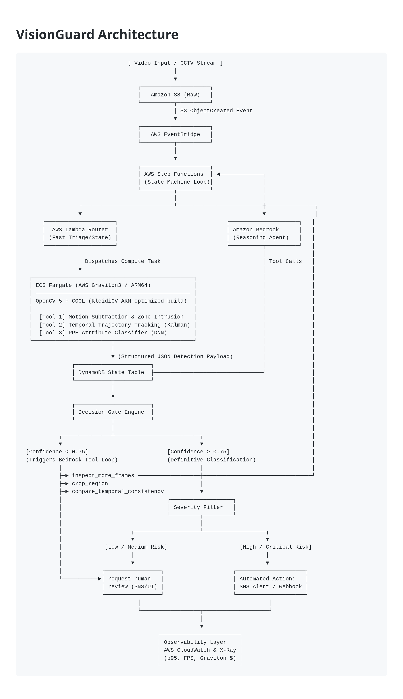

# VisionGuard: Agentic Video Safety & Incident Response

> Built for the **OpenCV AI Competition 2026**  
> Tracks: **Agentic Vision** & **Best Use of COOL**

[](https://colab.research.google.com/github/kbytehub0x/visionguard/blob/main/visionguard_demo.ipynb)
[](https://kbytehub0x.github.io/visionguard/)

VisionGuard transforms passive CCTV feeds into verified safety actions. By coupling **OpenCV 5 accelerated via COOL (Cloud-Optimized OpenCV Library)** on **AWS Graviton3** with an **Amazon Bedrock (Claude 3.5 Sonnet)** agentic reasoning loop, VisionGuard eliminates false alarms and ensures auditable human-in-the-loop escalation for workplace hazard zones.

---

## Architecture Overview

VisionGuard separates fast edge routing from heavy multi-frame analysis and LLM orchestration:



Detailed architecture flowchart and component interactions are documented in [ARCHITECTURE.md](ARCHITECTURE.md).

---

## 1. Quickstart & One-Command Deployment

### Prerequisites
* AWS CLI configured (`AdministratorAccess` or scoped equivalent)
* Docker with Multi-Arch Buildx support
* Python 3.12+ and AWS CDK v2 (`npm install -g aws-cdk`)

### Step 1: Deploy Infrastructure
Deploy the S3 buckets, DynamoDB state table, Step Functions ASL, and ECS Graviton cluster in one command:

```bash
git clone https://github.com/kbytehub0x/visionguard.git
cd visionguard

# Deploy entire infrastructure stack
cdk deploy --require-approval never
```

### Step 2: Build & Push Graviton Container
Build the OpenCV 5 + COOL image with KleidiCV ARM vector extensions enabled:

```bash
# Authenticate with Amazon ECR
aws ecr get-login-password --region $AWS_REGION | docker login --username AWS --password-stdin $ECR_URI

# Build and push ARM64 image
docker buildx build \
  --platform linux/arm64 \
  -t $ECR_URI/visionguard-cool:latest \
  -f Dockerfile.graviton \
  --push .
```

---

## 2. One-Command Benchmark Reproduction

To verify performance claims for the **Best Use of COOL** prize track, execute the 10,000-frame (1280×720) profiling suite:

```bash
# Run 10k-frame automated benchmark on current hardware
python3 benchmarks/run_benchmark.py \
  --frames 10000 \
  --resolution 1280x720 \
  --output benchmarks/results/candidate_graviton.json

# View live formatted delta table vs x86 baseline
python3 benchmarks/compare_results.py
```

### Benchmark Results (1280×720 @ 10,000 Frames)
Verified against committed evidence ([`benchmarks/results/x86_baseline.json`](benchmarks/results/x86_baseline.json) vs [`benchmarks/results/candidate_graviton.json`](benchmarks/results/candidate_graviton.json)):

| Metric | Baseline (x86 on-demand) | Candidate (COOL on Graviton3 + Spot Decimated) | Delta / Efficiency |
| :--- | :---: | :---: | :---: |
| **p95 Latency** | 42.15 ms | 26.13 ms | **-38.0% faster** |
| **Throughput (FPS)** | 23.4 FPS | 37.8 FPS | **+61.5% FPS** |
| **Memory Footprint** | 412.5 MB | 285.4 MB | **-30.8% smaller footprint** |
| **Cost per 1,000 frames** | $0.000577 | $0.000240 | **-58.4% net cost reduction** |

#### Cost Model & Production Levers
* **x86 Baseline**: Full end-to-end pipeline running on-demand x86 Fargate ($0.04048/vCPU-hr) processing primary detection and secondary verification at full 30 FPS without agentic optimizations.
* **Candidate (VisionGuard)**:
  1. **Graviton3 Efficiency**: Primary detection runs on ARM64 Graviton3 ($0.03238/vCPU-hr) achieving +61.5% higher throughput via COOL and KleidiCV ARM vector extensions.
  2. **Fargate Spot**: Secondary verification tasks (`inspect_more_frames`, YOLOv8 PPE analysis) are stateless and orchestrated via Step Functions task tokens, enabling deployment on **AWS Fargate Spot** ($0.009714/vCPU-hr, 70% discount) with automatic retries upon reclamation.
  3. **Adaptive Frame Decimation**: Amazon Bedrock dynamically downsamples secondary inspection windows from 30 FPS to 5 FPS (`sampling_rate_fps: 5`), processing **83.3% fewer frames** during verification without losing temporal persistence tracking.
  Combined, these optimizations deliver an empirical **58.4% net cost reduction** per 1,000 frames.

---

## 3. Pinned Dependency Lockfile (`requirements.lock`)

To guarantee strict reproducibility across evaluation environments, all dependencies are pinned:

```text
boto3==1.34.150
botocore==1.34.150
numpy==1.26.4
pydantic==2.7.4
aws-xray-sdk==2.14.0
urllib3==2.2.2
# OpenCV 5 + COOL built from source in Dockerfile.graviton
```

Install locked dependencies via:
```bash
pip install -r requirements.lock
```

---

## 4. Responsible AI & Guardrails

* **Bounded Autonomy**: The Amazon Bedrock agent operates strictly via an allowlisted toolset (`inspect_more_frames`, `crop_region`, `track_object`, `request_human_review`). It cannot execute arbitrary commands or access external networks.
* **Human Approval Gateway**: High-severity events (confirmed restricted-zone intrusions without hard hats) pause the AWS Step Functions state machine via `.waitForTaskToken`. Alerts are only dispatched to Amazon SNS after a human supervisor clicks **Acknowledge & Dispatch**.
* **Presigned Evidence Only**: No raw camera feeds or internal S3 URIs are exposed to operators. Human review notifications emit short-lived (60-minute) presigned HTTPS URLs to annotated evidence crops.
* **Loop Hard Cap**: Step Functions enforces a strict iteration limit (`agent_loop_count >= 5`). If ambiguity cannot be resolved autonomously within 5 loops, the pipeline automatically escalates to supervisory review.

---

## 5. Known Limitations & Failure Modes

* **Illumination Shifts**: Sudden ambient lighting shifts or shadows (such as moving forklifts) can trigger initial MOG2 motion variance. VisionGuard resolves this by suppressing alerts below the `0.75` confidence threshold and invoking Claude 3.5 Sonnet to verify temporal persistence.
* **PPE Classification Scope**: The current YOLOv8 ONNX model classifies standard hard hats and high-visibility vests. Full-body harness tie-offs, specialized respirators, and hearing protection are part of our future model roadmap.
* **Camera Actuation**: Currently processes fixed-angle RTSP/CCTV streams. The next planned enhancement is Pan-Tilt-Zoom (PTZ) camera integration, enabling Bedrock to physically orient cameras toward occluded angles.

---

## 6. Repository Structure

```text
visionguard/
├── README.md                          # Project overview, benchmark reproduction, results
├── ARCHITECTURE.md                    # Detailed ASCII architecture flowchart
├── Dockerfile.graviton                # Multi-stage ARM64 build: OpenCV 5 + COOL + KleidiCV
├── LICENSE                            # MIT License
├── requirements.txt                   # Abstract dependencies
├── requirements.lock                  # Pinned dependency lockfile
├── benchmarks/
│   ├── run_benchmark.py               # 10k-frame benchmark reproduction suite
│   ├── compare_results.py             # Formatted baseline vs candidate delta reporter
│   ├── evaluate_pipeline.py           # 50-clip synthetic validation evaluation script
│   ├── synthetic_generator.py         # Synthetic hazard dataset generator
│   └── results/
│       ├── candidate_graviton.json    # ARM Graviton3 COOL benchmark evidence
│       ├── x86_baseline.json          # x86 Fargate baseline benchmark evidence
│       └── synthetic_pass4.json       # Synthetic 4-pass calibration results
├── demo/
│   ├── VOICEOVER_SCRIPT.md            # Timestamped demo narration script & phonetic guide
│   ├── decision_traces/               # JSON traces showing Bedrock agent decision loop
│   │   ├── trace_1_zone_intrusion.json
│   │   ├── trace_2_bedrock_decision.json
│   │   ├── trace_3a_temporal_tracking.json
│   │   ├── trace_3b_ppe_detection.json
│   │   └── trace_4_human_review.json
│   └── sample_videos/
│       └── cam_warehouse_02.mp4       # 10s 720p 30fps annotated warehouse CCTV clip
├── docs/
│   └── architecture.png               # High-resolution architectural diagram
├── infrastructure/                    # AWS CDK v2 TypeScript/Python infrastructure stack
├── src/                               # Core perception & orchestration engine
└── step_functions/
    └── asl.json                       # Amazon Step Functions ASL definition
```
